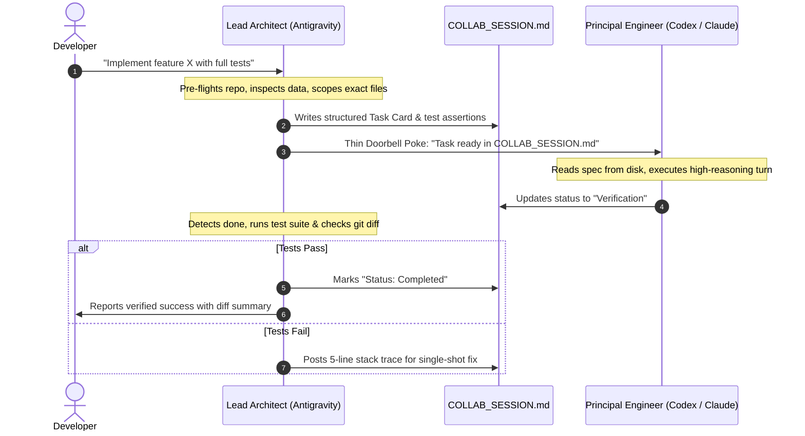

# 🤖 Multi-Agent Collab (`multi-agent-collab`)

[](LICENSE)
[]()
[]()

> **Token-efficient, asymmetric multi-agent software engineering using the "Blackboard + Thin Signal" pattern.**

`multi-agent-collab` is an agent workflow and skill that orchestrates multiple autonomous AI coding agents (such as **Google Antigravity / Gemini**, **OpenAI Codex**, and **Anthropic Claude Code**) operating together in **Herdr**, **tmux**, or terminal multiplexers.

---

## 💡 The Problem

When developers attempt to coordinate multiple AI coding agents, three critical issues emerge:

1. **💸 Token Quota Burn**: Routing massive project contexts, documentation, and raw file dumps directly into frontier reasoning models (e.g., GPT-6-Luna, Claude 3.7 Sonnet Thinking) rapidly depletes expensive token limits.
2. **📟 Terminal Buffer Pollution**: Ingesting multi-kilobyte code blocks and verbose instructions across terminal buffers (`herdr`, `tmux`, or stdin) causes prompt truncation, ANSI escape corruption, and context drift.
3. **💥 Unverified Code Regressions**: Agents often mark tasks "done" without executing local test harnesses or respecting immutable project invariants.

---

## 🏛️ The Solution: "Blackboard + Thin Signal"

Instead of passing heavy prompts over CLI pipes, this workflow decouples **task specification** from **task signaling**:

* **`AGENT_HUB.md` (Permanent Truth)**: Enduring project handbook defining architectural invariants, tech stack, role assignments, and strict safety boundaries (e.g., protected datasets or secrets).
* **`COLLAB_SESSION.md` (Active Blackboard)**: File-based task board containing precise input file paths, line ranges, implementation constraints, and deterministic test commands.
* **Thin Signal ("Doorbell Poke")**: Agents communicate via 1-line trigger commands (`herdr`, `tmux`, or CLI pokes) instructing the worker agent to read `COLLAB_SESSION.md` directly from disk.



---

## 👥 Asymmetric Team Roles

| Role | Default Agent | Strength & Primary Responsibility |
| :--- | :--- | :--- |
| **Lead Architect & Preparer** | **Antigravity / Gemini** | **Fast, massive context (1M+ tokens), rich tooling.** Scans repos, pre-flights dependencies, explores raw data, constructs unambiguous task cards, runs tests, and audits regressions. |
| **Principal Engineer & Closer** | **Codex (GPT-6-Luna)** | **Maximum reasoning & algorithmic precision.** Reads pre-digested task cards directly from disk, authors intricate logic/refactors in a single high-leverage turn, preserving expensive quota. |
| **Specialist Builder & Auditor** | **Claude Code / Agent 3** | **Large multi-file refactoring & test authoring.** Implements parallel branch workstreams, independent security reviews, and secondary code audits. |

---

## 📦 Installation

### 1. Global Installation (Antigravity / Gemini CLI)
Install globally to make the skill automatically accessible across all projects on your workstation:

#### Windows (PowerShell):
```powershell
git clone https://github.com/<your-username>/multi-agent-collab.git "$HOME\.gemini\config\skills\multi-agent-collab"
```

#### macOS / Linux (Bash):
```bash
git clone https://github.com/<your-username>/multi-agent-collab.git ~/.gemini/config/skills/multi-agent-collab
```

---

### 2. Single Project / Workspace Installation
If you want to commit this workflow to a specific project repository:

```bash
mkdir -p .agents/skills
git clone https://github.com/<your-username>/multi-agent-collab.git .agents/skills/multi-agent-collab
```

---

## 🚀 Quick Start

### Step 1: Initialize in Your Project
Run the setup script inside your project root to generate `AGENT_HUB.md` and `COLLAB_SESSION.md`:

**Windows (PowerShell):**
```powershell
powershell -ExecutionPolicy Bypass -File "path/to/scripts/init-collab.ps1"
```

**macOS / Linux (Bash):**
```bash
bash path/to/scripts/init-collab.sh
```

*(Or simply ask Antigravity: `"Set up multi-agent collaboration for this project"` — it will activate the skill and run the initializer automatically.)*

---

### Step 2: Configure Workspace Panes (Herdr Example)
If using [Herdr](https://github.com) or `tmux`, configure side-by-side agent panes:

```bash
# Split current pane to the right
herdr pane split --current --direction right --cwd "$PWD" --no-focus

# Launch Codex in the right pane
herdr agent start codex --kind codex --pane <pane-id>
```

---

### Step 3: Run the Blackboard Workflow

1. **Antigravity fills the task card** in `COLLAB_SESSION.md`:
   ```markdown
   ### Active Task Card: TASK-001
   - Objective: Refactor authentication handler to support token rotation.
   - Input Files: `src/auth/tokens.py` (lines 45-110)
   - Constraints: Do not modify user session cache schema.
   - Acceptance Criteria: `pytest tests/test_auth.py` exits 0.
   ```
2. **Send the thin doorbell poke**:
   ```bash
   herdr agent prompt codex "Task ready in COLLAB_SESSION.md. Run self-check when done." --wait
   ```
3. **Antigravity runs the test harness**:
   Once Codex signals completion, Antigravity verifies test execution before committing changes.

---

## 🛡️ Golden Rules for Multi-Agent Workspaces

1. **Protect Premium Quotas**: Never let reasoning-heavy models wander aimlessly searching directories. Feed them concise, pre-scoped files.
2. **Never Touch Protected Directories**: Canonical datasets, journals, and credentials should always be declared strictly read-only in `AGENT_HUB.md`.
3. **Deterministic Verification**: No task is marked complete without green assertions. Assertions beat assumptions every time.

---

## 📄 License

This project is licensed under the [MIT License](LICENSE).
